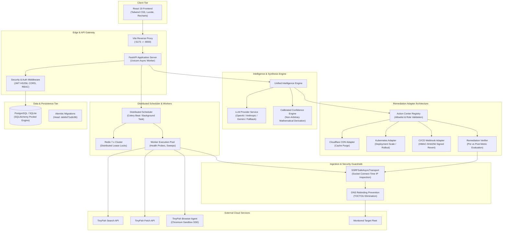
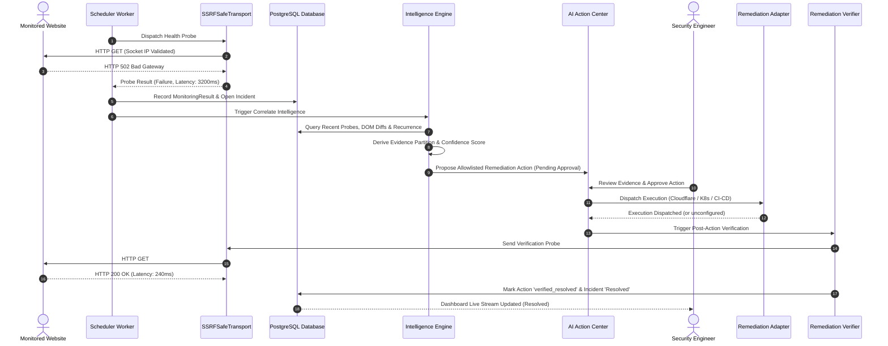

# WebGuard AI — System Architecture Documentation

**Document Version:** 2.0.0  
**Target Platform:** WebGuard AI Enterprise Core  

---

## 1. Architectural Overview

WebGuard AI is built as a **modular, event-driven, micro-service capable architecture** designed for high security, distributed scalability, and evidence-driven AI reasoning. The system is split cleanly into:
1. **Interactive Client Tier:** React 19 SPA running with Tailwind CSS and Vite.
2. **API & Orchestration Tier:** FastAPI asynchronous server with connection-time socket security.
3. **Intelligence & Correlation Tier:** Unified Multi-Module Correlation Engine with LLM abstraction and deterministic fallback.
4. **Worker & Distributed Scheduler Tier:** Celery + Celery Beat + Redis distributed lease locks (with in-process lease fallback).
5. **Remediation Execution Layer:** Sandboxed adapter layer interfacing with Cloudflare, Kubernetes, and CI/CD pipelines.
6. **Data Storage & Persistence Tier:** PostgreSQL with connection pooling (SQLite local fallback) managed via Alembic migrations.

---

## 2. High-Level Architecture Diagram



---

## 3. Component Deep Dive

### 3.1 Ingestion & Transport Tier (Socket-Level Security)
Located in [`backend/app/core/security.py`](file:///d:/WebGuard%20AI/backend/app/core/security.py).  
Traditional HTTP clients suffer from Time-of-Check to Time-of-Use (**TOCTOU**) DNS rebinding vulnerabilities: an attacker configures DNS with TTL=0 to resolve first to an allowed public IP, then immediately re-binds to `127.0.0.1` or `169.254.169.254` on subsequent TCP handshakes.
- **`SSRFSafeAnyIOBackend(httpcore.AnyIOBackend)`:** Intercepts `connect_tcp` at the exact operating-system socket layer. Destination IPs are resolved and cross-checked against the `FORBIDDEN_NETWORKS` CIDR tables immediately before the TCP SYN handshake begins.
- **`SSRFSafeAsyncTransport(httpx.AsyncHTTPTransport)`:** Hooks the custom network backend directly into HTTPX client connection pools.
- **Redirect Event Hooks:** Validates the target `Location` header on every HTTP 3xx hop, blocking chains exceeding 5 hops.

### 3.2 Unified Intelligence Engine & Confidence Calibration
Located in [`backend/app/services/intelligence_engine.py`](file:///d:/WebGuard%20AI/backend/app/services/intelligence_engine.py).  
Correlates disparate telemetry streams without inventing causal relationships:
- Health check telemetry (HTTP error codes, probe latencies).
- Semantic DOM diffs (release markers within 24h of failure).
- Competitor pricing drops (market pressure contextualization).
- TinyFish browser execution logs (console errors, rendered DOM element failures).
- Historical recurrence (matching title signatures and prior MTTR).

All findings are mapped into strict structures:
```json
{
  "confirmed_facts": [...],
  "observations": [...],
  "hypotheses": [...],
  "unknown": [...]
}
```

The confidence score is mathematically calibrated:
$$S = \text{clamp}(0.10 + W_{\text{telemetry}} + W_{\text{DOM}} + W_{\text{browser}} + W_{\text{history}} + B_{\text{diversity}} - P_{\text{contradiction}}, 0.05, 0.98)$$

### 3.3 Safe Remediation Execution Architecture
Located in [`backend/app/services/remediation/`](file:///d:/WebGuard%20AI/backend/app/services/remediation/):
- **Base Interface (`BaseRemediationAdapter`):** Mandates `adapter_name`, `is_configured()`, and asynchronous `execute(parameters, idempotency_key)`.
- **Full Action Lifecycle:**
  `proposed` $\rightarrow$ `pending_approval` $\rightarrow$ `approved` $\rightarrow$ `executing` $\rightarrow$ `executed` $\rightarrow$ `verifying` $\rightarrow$ `verified_resolved` (or `integration_unconfigured` / `verification_failed`).
- **Post-Action Verification (`RemediationVerifier`):** Immediately triggers independent socket-level probes to evaluate pre- vs. post-remediation status code and latency delta, optionally running synthetic browser tests.

### 3.4 Distributed Worker & Lease Lock Engine
Located in [`backend/app/services/scheduler.py`](file:///d:/WebGuard%20AI/backend/app/services/scheduler.py):
- Uses Redis distributed keys (`webguard:lease:<task_id>`) with expiration TTLs to guarantee that multiple horizontal backend instances do not trigger identical probe jobs concurrently.
- Local development fallback dynamically switches to in-process memory locks when Redis is unconfigured.
- Exposes worker state through `GET /api/v1/dashboard/system-status`.

### 3.5 Database & Migration Layer
- **ORM:** SQLAlchemy with declarative data models for Organizations, Users, Websites, MonitoringTasks, MonitoringResults, Incidents, Competitors, Products, PriceHistories, TinyFishExecutions, and AIActions.
- **Multi-Tenancy:** Hard row-level filtering enforces `organization_id` on every select, insert, update, and delete query.
- **Migrations:** Managed through Alembic, guaranteeing deterministic forward upgrades and clean rollbacks.

---

## 4. End-to-End Data Flow: Incident Lifecycle



