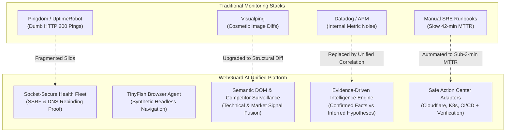

# WebGuard AI — Competitive Differentiation & Technology Comparison

**Document Version:** 2.0.0  
**Focus:** Competitive Landscape Analysis & Unique Architectural Advantages  

---

## 1. The Operational Gap in Existing Tooling

Enterprise software operations are fragmented across disconnected tool silos:
- **Uptime Monitors (UptimeRobot, Pingdom):** Shallow synthetic pingers that test `GET /` every 5 minutes. They miss client-side JavaScript crashes and visual breakage entirely.
- **APM Platforms (Datadog, New Relic, Dynatrace):** Complex, expensive metric firehoses. They report internal CPU/memory spikes but have zero awareness of customer-facing DOM changes or external competitor pricing shifts.
- **Error Trackers (Sentry, Bugsnag):** Capture stack traces after errors happen, but lack end-to-end autonomous remediation, browser replay, or market intelligence.
- **Website Change Trackers (Visualping, Versionista):** Send screenshot diff emails when a paragraph changes, but have no concept of SRE incidents, container rollbacks, or edge CDN flushes.

**WebGuard AI** unifies these disparate worlds into an **integrated, evidence-driven autonomous platform**.

---

## 2. Comprehensive Competitive Matrix

| Feature / Dimension | WebGuard AI | Datadog / Dynatrace | Pingdom / UptimeRobot | Sentry | Visualping |
|---|---|---|---|---|---|
| **Synthetic Endpoint Monitoring** | Yes (Sub-minute roundtrips) | Yes | Yes (Basic ping) | No | No |
| **Deep Browser Automation** | Yes (TinyFish Headless Agent) | Add-on (High Cost) | No | No | No |
| **Semantic DOM Change Detection** | Yes (Structured Diff Classification) | No | No | No | Yes (Visual diff only) |
| **Competitor Pricing Surveillance** | Yes (Multi-currency normalization) | No | No | No | Partial (Unstructured) |
| **Evidence-Driven Root Cause Partition** | Yes (Confirmed Facts, Observations, Hypotheses, Unknown) | Proprietary Watchdog (Opaque) | No | Basic Traceback | No |
| **Calibrated Confidence Score** | Yes (Non-arbitrary mathematical derivation) | Arbitrary Alert Scoring | No | No | No |
| **Safe Remediation Adapters** | Yes (Cloudflare, K8s, CI/CD) | Runbooks (Manual Setup) | No | No | No |
| **Post-Remediation Verification** | Yes (Automated pre/post metric assertion) | No | No | No | No |
| **Socket-Level TOCTOU SSRF Defense** | Yes (`SSRFSafeAnyIOBackend`) | Standard HTTP Client | Basic IP Filtering | Standard HTTP Client | Standard HTTP Client |
| **Multi-Tenant Row Isolation** | Yes (Strict RLS on all queries) | Enterprise RBAC | Simple Team Accounts | Team Workspaces | Single-tenant Accounts |
| **Token Cost Optimization** | Deterministic fallback ($0.00 cost) | Vendor Lock-in | N/A | N/A | N/A |

---

## 3. Core Architectural Differentiators

### 3.1 Fusion of Reliability and Market Intelligence
In traditional companies, when a major site outage occurs:
- The SRE team scrambles to look at CPU charts.
- The marketing team is unaware of the outage.
- A competitor slashes prices by 30%, capturing frustrated users attempting to complete a purchase.

WebGuard AI is the **first platform to correlate operational downtime with competitor price shifts**, immediately alerting stakeholders to commercial churn risks in the incident brief.

### 3.2 Zero-Hallucination Evidence Partitioning
Standard AI incident tools generate lengthy paragraphs of plausible-sounding text that often hallucinate causes (e.g. claiming a database failed when DNS was down).  
WebGuard AI enforces an **unforgiving 4-category partition**:
1. **CONFIRMED FACTS:** Hard telemetry evidence (HTTP status codes, latency spikes, browser console exceptions).
2. **OBSERVATIONS:** Measured metrics (probe counts, diff sizes, temporal proximity).
3. **HYPOTHESES:** Inferred root causes with stated rationale and verification steps.
4. **UNKNOWN:** Unobservable telemetry gaps stated honestly (e.g., absence of APM traces).

### 3.3 Socket-Level SSRF & Rebinding Defense
Unlike legacy uptime tools that rely on naive hostname string regexes, WebGuard AI intercepts outgoing TCP handshakes inside the connection pool via `SSRFSafeAnyIOBackend`. It handles:
- Decimal (`http://2130706433/`), Hex (`0x7f000001`), Octal (`0177.0.0.1`) notation
- IPv4-mapped IPv6 (`::ffff:127.0.0.1`)
- DNS rebinding with zero-TTL lookups
- Strict 5-hop redirect depth limits

### 3.4 Closed-Loop Remediation with Verification
Legacy platforms stop at sending an alert. WebGuard AI closes the operational loop:
1. Proposes allowlisted, low-risk or high-risk remediation actions (CDN cache purges, K8s deployment restarts, CI/CD rollbacks).
2. Gated by authenticated human approval (RBAC).
3. Dispatches actions through safe adapters.
4. **Automatically runs post-action verification probes** comparing pre-remediation failure metrics to post-remediation metrics.
5. Marks the incident `Resolved` **only** when verified recovery is empirically observed.

