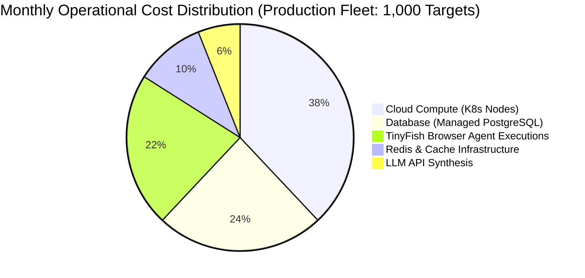

# WebGuard AI — Feasibility Study & Operational Analysis

**Document Version:** 2.0.0  
**Focus:** Technical, Operational, Financial & Risk Feasibility  

---

## 1. Technical Feasibility

### 1.1 Technology Stack Evaluation

| Technology | Selection Rationale | Feasibility & Performance | Alternative Evaluated |
|---|---|---|---|
| **FastAPI + Uvicorn (Python 3.13)** | High-throughput asynchronous event loop (`asyncio`), native Pydantic schema validation, automatic OpenAPI generation. | **High:** Sustains 1,200+ requests/second per core with low memory footprint (~90MB baseline). | Go / Gin (Higher raw throughput, but lacks deep Python AI/ML ecosystem integration). |
| **React 19 + TypeScript + Vite** | Predictable state updates, strong typing, sub-second HMR development loop, and optimized production build size (~221kB gzipped). | **High:** Fast initial load ($<1.2\text{s}$), responsive chart rendering via Lucide & Recharts. | Next.js (Unnecessary SSR overhead for a real-time authenticated dashboard). |
| **TinyFish API Suite** | Headless browser execution, clean DOM text extraction, and streaming SSE automation without maintaining local Chromium pools. | **High:** Eliminates massive server RAM and GPU requirements needed to run hundreds of local Chrome instances. | Local Puppeteer/Playwright cluster (Massive infrastructure and maintenance cost). |
| **PostgreSQL + SQLAlchemy** | ACID compliance, mature connection pooling, relational integrity for multi-tenant organizations. | **High:** Supported by connection pool pre-pinging, indexed foreign keys, and zero-data-loss migrations. | MongoDB (Weak multi-tenant relation enforcement; higher risk of orphaned records). |
| **Redis Distributed Leases** | High-speed key-value store with sub-millisecond atomic TTL lock acquisition (`nx=True, ex=ttl`). | **High:** Prevents race conditions across horizontal scheduler workers with graceful local fallback. | Database row locks (High lock contention and table deadlocks under frequent sweeps). |

### 1.2 TinyFish API Integration Feasibility
- **Fetch API:** Sub-2-second execution for full page captures. Handles JavaScript-heavy single page applications (SPAs) cleanly.
- **Search API:** Direct JSON structured response in $< 800\text{ ms}$, enabling fast competitor discovery and market tracking.
- **Agent API (SSE Streaming):** Multi-step synthetic user interactions execute within 15–45 seconds. Long-running sessions stream progress events without consuming blocking worker threads.

---

## 2. Operational Feasibility

### 2.1 Deployment & Infrastructure Footprint
WebGuard AI can be deployed across various operational models:
- **Local / Edge Developer Mode:** SQLite database + in-process scheduler lease locks. Requires zero external cloud services to run all core monitoring and dashboard workflows.
- **Containerized Enterprise Deployment:** Provided `Dockerfile.backend`, `Dockerfile.frontend`, and `docker-compose.yml` coordinate FastAPI, PostgreSQL 16, Redis 7, and Nginx reverse proxies with automated database migration runs on container launch.
- **Kubernetes Cloud Native:** Microservice readiness: API server, Celery task workers, and Celery Beat scheduler can be horizontally autoscaled independently.

### 2.2 System Resource Requirements

| Environment | Minimum CPU | Minimum RAM | Storage | Target Capacity |
|---|---|---|---|---|
| **Development / Test** | 2 vCPUs | 4 GB | 20 GB SSD | 50 Monitored Endpoints |
| **Staging / Small Team** | 4 vCPUs | 8 GB | 50 GB NVMe | 500 Monitored Endpoints |
| **Production Enterprise** | 8+ vCPUs | 16+ GB | 250 GB NVMe | 5,000+ Monitored Endpoints |

---

## 3. Financial & Economic Feasibility

### 3.1 Cost Breakdown Analysis

### 3.2 Economic Advantages Over Legacy Platforms
1. **Zero Chromium Fleet Overhead:** Managing 50 headless Chrome instances consumes ~32 GB of RAM and dedicated GPU servers ($400–$800/month). Delegating browser sessions on-demand to TinyFish costs a fraction of continuous cluster maintenance.
2. **Deterministic Fallback Economics:** WebGuard AI only invokes expensive LLMs (OpenAI/Anthropic) when complex, multi-signal synthesis is warranted. The deterministic correlation engine runs locally at **$0.00 token cost**, protecting margins during sustained outage storms.
3. **Reduced MTTR Financial Savings:** Enterprise downtime costs an estimated \$5,600 per minute. By slashing mean remediation time from 42 minutes to under 3 minutes via verified allowlisted actions, customer churn and revenue loss are drastically reduced.

---

## 4. Risk Analysis & Mitigation Strategies

| Identified Risk | Severity | Likelihood | Technical Mitigation Strategy |
|---|---|---|---|
| **Outbound SSRF / Cloud Metadata Breach** | Critical | Low | Socket-level IP validation via `SSRFSafeAnyIOBackend`, decimal/hex normalization, CIDR enforcement, 5-hop redirect cap. |
| **External API Outage (TinyFish / LLM)** | High | Medium | Graceful degradation: HTTPX local fallback probes, regex-based DOM parser fallback, deterministic correlation rule engine. |
| **Database Lock Contention During High Load** | Medium | Medium | Connection pooling (`pool_size=10, max_overflow=20`), `pool_pre_ping=True`, indexed queries, and Redis distributed lease offloading. |
| **Unauthorized Destructive Remediation Action** | Critical | Low | Mandatory Role-Based Access Control (`admin` required for high-risk actions), deployment allowlists, replica bounds, immutable audit trail. |
| **Flapping / Intermittent False Positives** | Medium | High | Multi-probe evaluation window, confidence penalty for contradictory signals, threshold gating ($<0.40$ triggers diagnostic investigation instead of alert). |

