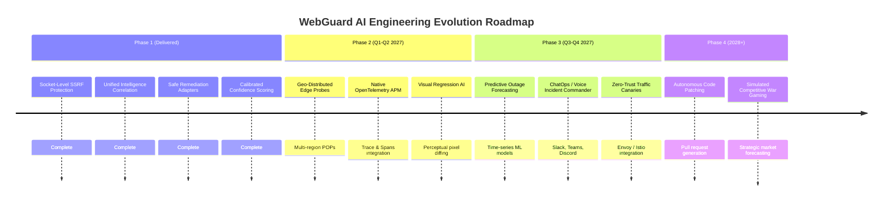

# WebGuard AI — Future Scope & Product Roadmap

**Document Version:** 2.0.0  
**Horizon:** 2026 – 2028 Strategic Evolution  

---

## 1. Vision & Strategic Direction

WebGuard AI will expand from an autonomous monitoring and incident triage platform into an **Autonomous Site Reliability Engineering (SRE) Operating System**. 

The long-term vision is an intelligent platform capable not only of reacting to regressions, but **predicting anomalies, simulating competitive market moves, and automatically hardening web applications prior to public release.**

---

## 2. Multi-Phase Roadmap

---

## 3. Key Future Capabilities

### 3.1 Multi-Region Distributed Probing Network (Edge POPs)
- **Current State:** Probes originate from the primary cluster deployment location.
- **Future State:** Deploy lightweight, containerized Go/Rust edge probe workers across 18+ worldwide regions (US-East, US-West, EU-Central, APAC, LATAM).
- **Benefit:** Detects localized CDN degradation, regional DNS poisoning, and geo-specific censorship or routing anomalies.

### 3.2 Visual & Perceptual Regression AI
- **Current State:** Semantic DOM extraction comparing HTML element trees and text tokens.
- **Future State:** Integration of lightweight computer vision models (e.g. perceptual hash + convolutional diffing) comparing real viewport screenshots captured by TinyFish.
- **Benefit:** Detects visual glitches where CSS z-index bugs or broken flexboxes hide critical buttons even though the element exists in the raw DOM.

### 3.3 Deep APM & OpenTelemetry (OTel) Native Ingestion
- **Current State:** Synthetic endpoint probing and browser automation telemetry.
- **Future State:** OpenTelemetry Collector receiver endpoints accepting distributed traces, spans, and host metrics (CPU, Memory, DB Connection Pool saturation).
- **Benefit:** Closes the telemetry gap in the `UNKNOWN` partition of incident investigations, directly correlating an HTTP 502 with backend database connection pool exhaustion or unhandled worker exceptions.

### 3.4 Predictive Outage & Latency Forecasting
- **Current State:** Reactive threshold detection on active HTTP probes.
- **Future State:** Implementation of streaming time-series anomaly detection algorithms (e.g. Prophet, ARIMA, Isolation Forests).
- **Benefit:** Identifies creeping memory leaks and progressive latency degradation hours before an actual hard 500/502 outage occurs, proposing preventive scaling actions proactively.

### 3.5 Autonomous Code Patching & Git Integration
- **Current State:** Autonomous rollbacks to previous stable container revisions.
- **Future State:** AI code reasoning agent that inspects Git commits between the broken deployment and the previous healthy release, locates the faulty commit, and opens a GitHub / GitLab Pull Request with a targeted hotfix or cherry-pick revert.

### 3.6 ChatOps & Collaborative Incident Command
- **Current State:** In-app Action Center with manual review and approval.
- **Future State:** Two-way Slack, Microsoft Teams, and Discord integrations:
  - Dispatches interactive incident briefs with telemetry snapshots.
  - Allows verified on-call engineers to approve remediation directly via Slack interactive buttons with MFA verification.
  - Dispatches incident summary voice briefings to PagerDuty or telephone bridges during critical tier-1 outages.

