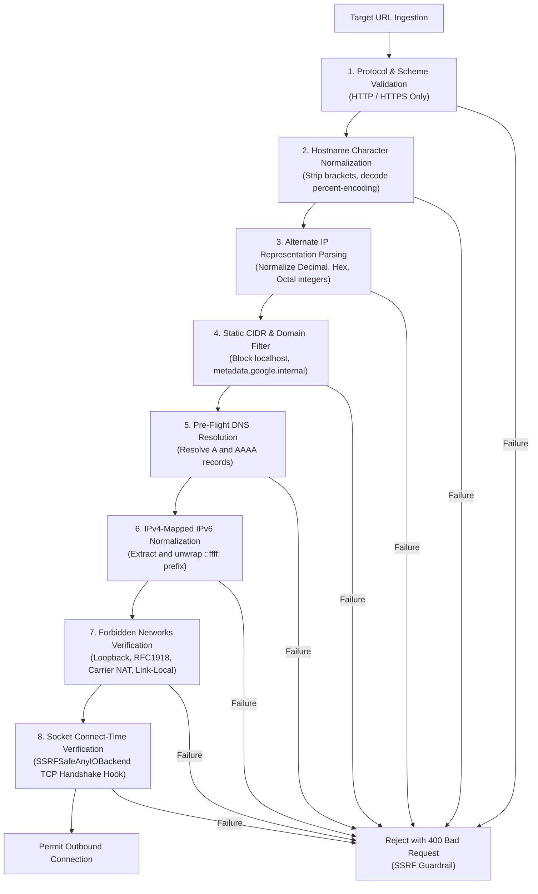

# WebGuard AI — Security Architecture & Threat Defense

**Document Version:** 2.0.0  
**Classification:** Enterprise Security Standard  

---

## 1. Security Philosophy & Principles

WebGuard AI operates with an adversarial mindset: **assume the monitored endpoint or competitor URL is potentially hostile or under attacker control.**

Because monitoring systems make automated outbound HTTP requests, fetch external DOM trees, execute browser automation, and trigger infrastructure webhooks, they are prime targets for:
- Server-Side Request Forgery (**SSRF**)
- DNS Rebinding Attacks (**TOCTOU**)
- Cloud Metadata Theft (AWS `169.254.169.254`, GCP `metadata.google.internal`)
- Webhook Replay & Hijacking Attacks
- Cross-Tenant Data Leaks
- Unauthorized Autonomous Execution

---

## 2. Advanced SSRF Defense Matrix

Traditional application security relies on simple hostname string checks or pre-request DNS lookups. WebGuard AI enforces a multi-layered defense-in-depth model:



### 2.1 Forbidden Network CIDR Blocks
The following network blocks are strictly forbidden from outbound communication:
- Loopback: `127.0.0.0/8`, `::1/128`
- RFC 1918 Private: `10.0.0.0/8`, `172.16.0.0/12`, `192.168.0.0/16`
- Cloud Metadata: `169.254.0.0/16`, `fd00:ec2::/64`
- Carrier-Grade NAT: `100.64.0.0/10`
- Kubernetes Pod & Service Networks: `10.96.0.0/12`
- IPv4-Mapped IPv6: `::ffff:0:0/96`
- Broadcast / Multicast / Reserved: `224.0.0.0/4`, `240.0.0.0/4`, `255.255.255.255/32`

### 2.2 Alternate IP Encodings Handled
Attackers frequently obfuscate internal IP addresses to evade standard string filters. WebGuard AI normalizes and blocks:
- **Decimal Notation:** `http://2130706433/` $\rightarrow$ normalized to `127.0.0.1` and blocked.
- **Hexadecimal Notation:** `http://0x7f000001/` $\rightarrow$ normalized to `127.0.0.1` and blocked.
- **Octal Notation:** `http://0177.0.0.1/` $\rightarrow$ normalized to `127.0.0.1` and blocked.
- **IPv4-Mapped IPv6:** `http://[::ffff:127.0.0.1]/` $\rightarrow$ unwrapped to `127.0.0.1` and blocked.

---

## 3. Socket-Level Connection-Time DNS Rebinding (TOCTOU) Protection

Standard DNS validation is vulnerable to DNS Rebinding:
1. Attacker controls domain `rebind.evil.com`.
2. First query returns public IP `93.184.216.34` with `TTL=0`. Pre-validation passes.
3. Milliseconds later, when the client establishes the TCP connection, DNS resolves to `169.254.169.254`.

### WebGuard AI Socket Interceptor
WebGuard AI overrides the underlying transport using `SSRFSafeAnyIOBackend(httpcore.AnyIOBackend)`:
```python
class SSRFSafeAnyIOBackend(httpcore.AnyIOBackend):
    async def connect_tcp(self, host: str, port: int, ...):
        # Resolves destination immediately before OS socket connection
        addr_info = socket.getaddrinfo(host, port, proto=socket.IPPROTO_TCP)
        for entry in addr_info:
            ip = ipaddress.ip_address(entry[4][0])
            verify_ip_is_public(ip) # Hard abort if IP is private/metadata
        return await super().connect_tcp(host, port, ...)
```
By resolving and enforcing safety at the exact moment of socket creation inside the connection pool, the TOCTOU window is reduced to zero.

---

## 4. Redirect Chain Depth & Target Safety

Malicious sites often return `HTTP 302` redirects to internal services or build infinite redirect loops.
- **Event Hook:** All HTTPX clients register `validate_redirect_response` as an async event hook.
- **Depth Limiter:** Tracks the redirect hop counter on the request extensions object. Any chain exceeding **5 hops** is aborted immediately.
- **Per-Hop Validation:** The `Location` header is joined to the request URL and validated through the complete SSRF verification pipeline before the next connection is attempted.

---

## 5. Multi-Tenant Row-Level Isolation (RLS)

All database operations enforce tenant boundaries:
- The user's authenticated `organization_id` is extracted from the cryptographically verified JWT access token.
- Every read, write, update, and delete query in the repository and service layers mandates `filter(Model.organization_id == current_user.organization_id)`.
- Cross-tenant data retrieval returns an empty set or a `404 Not Found`, preventing tenant enumeration attacks.
- Automated tests (`test_organization_multi_tenant_isolation`, `test_cross_organization_data_isolation`) run on every CI build to verify that Tenant B cannot access Tenant A's websites, incidents, or actions.

---

## 6. Authentication, Session Security & Secrets Entropy

- **JSON Web Tokens (JWT):** Signed via HMAC-SHA256 (`HS256`).
- **Production Mode Entropy Guard:** In `ENVIRONMENT=production`, the application refuses to start if:
  - `SECRET_KEY` has fewer than 32 characters.
  - `SECRET_KEY` matches any known default or dictionary phrase (e.g. `webguard-super-secret-key-change-in-production-2026`).
  - Database URL points to an insecure local file rather than an encrypted connection string.
- **Password Hashing:** Uses `bcrypt` with work factor 12. Plaintext passwords are never stored, logged, or serialized.

---

## 7. Remediation Execution Security & Audit Logging

To prevent autonomous agents from making destructive changes without authorization:
- **Strict Role-Based Access Control (RBAC):** Low-risk actions (e.g. `GENERATE_INCIDENT_BRIEF`, `EXECUTE_SYNTHETIC_PROBE`) can be approved by standard operators. High-risk actions (`SCALE_WORKER_POOL`, `FLUSH_CDN_EDGE_CACHE`, `ROLLBACK_LAST_DEPLOYMENT`) require verified `admin` role credentials.
- **Deployment Allowlist:** The Kubernetes adapter permits scaling/rollback only on allowlisted deployments:
  `webguard-ingress`, `webguard-worker`, `webguard-api`, `webguard-backend`, `webguard-proxy`.
- **Replica Clamping:** Scales are strictly clamped between a minimum of 1 and maximum of 10 replicas.
- **Cryptographic Webhook Signatures:** Outbound CI/CD rollbacks include an HMAC-SHA256 signature in the `X-WebGuard-Signature` header, computed with a shared secret, timestamp header (`X-WebGuard-Timestamp`), and UUIDv4 anti-replay nonce (`X-WebGuard-Nonce`).
- **Immutable Audit Logging:** Every proposal, human approval note, dispatch timestamp, and execution result is stored permanently in the database.

